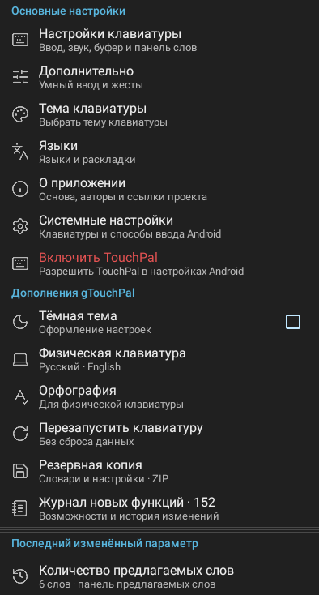
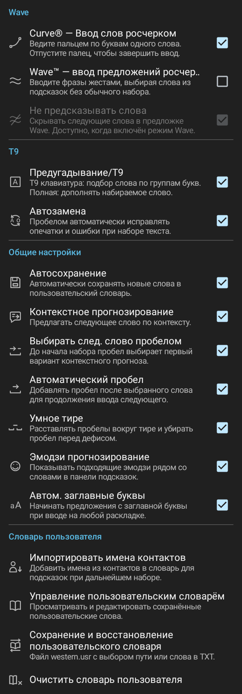
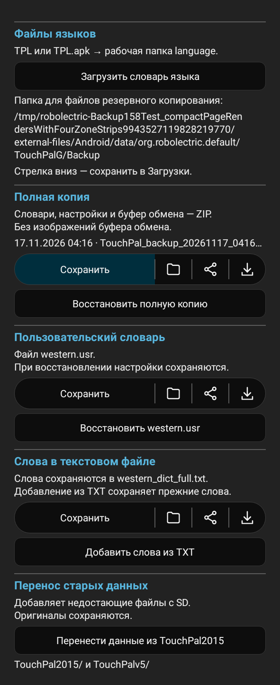

# gTouchPal

[<kbd>🇷🇺 Русский</kbd>](#русский) &nbsp; [<kbd>🇬🇧 English</kbd>](#english)

## Русский

Клавиатура для Android с жестами, подсказками слов и настройкой под себя.

**[Скачать APK 158](https://github.com/GokSssss/gTouchPal/releases/download/v158/158-gTouchPal-6.2.7.1.apk)**

### Что умеет

- **Набор текста:** раскладка T9, подсказки слов и ввод жестом Wave.
- **Настройки ввода:** разделы Wave и T9, «Предугадывание/Т9», «Автозамена» и контекстные подсказки. Выбор следующего слова пробелом доступен при включённом контекстном прогнозировании.
- **Физическая клавиатура:** русская и английская раскладки; в системном списке — «gTouchPal RU/en» и «gTouchPal EN/ru».
- **Курсор и язык:** управление курсором удержанием левой части пробела; переключение языка свайпом по пробелу.
- **Слова:** долгое нажатие на подсказку открывает редактирование и удаление слова.
- **Резервная копия и восстановление:** ZIP, western.usr и списки слов TXT. Копии хранятся в Backup рабочей папки приложения. «Восстановить» показывает локальные копии нужного формата, значок папки открывает системный выбор файла. Значки отправки и Загрузки сохраняют прежние действия; удержание показывает справку, после сохранения видно имя и папку файла. Выбранные для восстановления файлы сохраняются в Backup. Добавление из TXT сохраняет существующие слова.
- **Файлы языков:** загрузка TPL и TPL.apk через системный файловый менеджер в рабочую language. При замене сохраняется прежний файл.
- **Буфер обмена:** вставка текста из отдельной панели и быстрый возврат к клавиатуре.
- **Оформление:** выбор установленной темы клавиатуры с отмеченной текущей; светлая и тёмная темы настроек, размеры клавиатуры и панели подсказок. Высоты клавиатуры для портрета и альбома сохраняются отдельно; альбомная по умолчанию — 550 px. Готовые значения и перетягивание края доступны на макете.
- **Журнал функций:** актуальные возможности и история их изменений, открывается нажатием на **Журнал новых функций**.
- **Диагностика:** долгое нажатие на строку журнала открывает её команды и отчёты.
- **Ручное включение:** настройки открываются без запроса активации. Под системными настройками — «Включить TouchPal», красным до включения или выбора клавиатуры. Нажатие открывает включение Android или системный выбор клавиатуры. Цвет обновляется сразу при смене клавиатуры.

Установка поверх предыдущей версии без удаления данных. Проверочный выпуск; проверка на телефоне ещё предстоит. Для Obtainium включите **Предварительные выпуски**.

Снимок Android Views в тестовой среде, не фотография телефона.

[История версий](CHANGELOG.md#русский) · [Файлы выпуска](https://github.com/GokSssss/gTouchPal/releases/tag/v158) · [Проект на Диске](https://drive.google.com/drive/folders/1NWJDsJgyUYaAAxZZLaDB_INjzJ4yHbmH)

[↑ Русский / English](#gtouchpal)

---

## English

An Android keyboard with gestures, word suggestions and adjustable appearance.

**[Download APK 158](https://github.com/GokSssss/gTouchPal/releases/download/v158/158-gTouchPal-6.2.7.1.apk)**

### Features

- **Typing:** T9 layout, word suggestions and Wave gesture input.
- **Input settings:** Wave and T9 sections, word prediction, autocorrection and contextual suggestions. Selecting the next word with Space is available while contextual prediction is enabled.
- **Physical keyboard:** Russian and English layouts; the system picker shows “gTouchPal RU/en” and “gTouchPal EN/ru”.
- **Cursor and language:** hold the left side of the spacebar to move the cursor; swipe along it to switch languages.
- **Words:** long-press a suggestion to edit or delete the word.
- **Backup and restore:** ZIP, western.usr and TXT word lists. Copies are kept in the app workspace’s Backup folder. Restore lists local copies of the selected format; the folder icon opens the system file chooser. Share and Downloads have separate icons; hold for help. A successful save shows the filename and folder. Confirmed restore inputs are retained in Backup. TXT import keeps existing words.
- **Language files:** import TPL or TPL.apk through the system file chooser into the working language folder; replaced files are backed up.
- **Clipboard:** paste from a separate panel and return quickly to the keyboard.
- **Appearance:** choose an installed keyboard theme with the current one marked; light and dark settings themes, keyboard and suggestion-panel sizing. Portrait and landscape keyboard heights are saved separately; landscape defaults to 550 px. Presets and edge dragging are available in the preview.
- **Feature journal:** current features and their history, opened by tapping the journal.
- **Diagnostics:** hold the journal row to open diagnostic actions and reports.
- **Manual activation:** settings open without an activation prompt. Below system keyboard settings, “Включить TouchPal” (Enable TouchPal) is red until the keyboard is enabled and selected. Tap it to enable the keyboard in Android settings or open the system keyboard picker. Its colour updates immediately when the selected keyboard changes.

Install over the previous version without deleting data. Preview release; phone testing is still pending. Enable **Pre-releases** in Obtainium.

Android Views captured in the test environment, not a phone photograph.

[Version history](CHANGELOG.md#english) · [Release files](https://github.com/GokSssss/gTouchPal/releases/tag/v158) · [Project on Drive](https://drive.google.com/drive/folders/1NWJDsJgyUYaAAxZZLaDB_INjzJ4yHbmH)

[↑ Русский / English](#gtouchpal)

---

Развитие TouchPal Deluxe и идейное продолжение модификации Tanh на основе TouchPal Keyboard 6.2.7.1. Дальнейшая работа — GokS. Оригинальная основа — CooTek.

Based on TouchPal Deluxe and continuing Tanh's modification of TouchPal Keyboard 6.2.7.1. Further development by GokS. Original base by CooTek.

[Пост Tanh на 4PDA / Tanh on 4PDA](https://4pda.to/forum/index.php?showtopic=256287&view=findpost&p=139436147) · [Лицензии значков / Icon licenses](ui156/research/icon-sources) · [Для разработчика / Developer documentation](docs/DEVELOPMENT.md)
